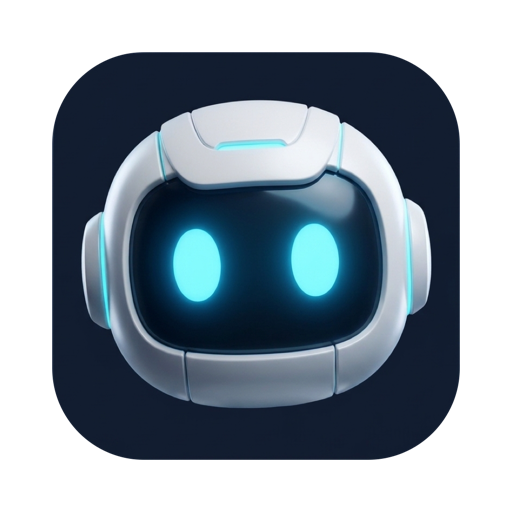
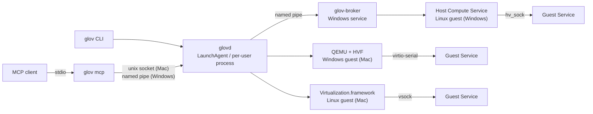

<p align="center"></p>

# glov

glov runs virtual machines for AI agents: Windows and Linux VMs on an Apple silicon Mac, and Linux VMs on a
Windows PC ([Windows host](docs/windows-host.md)). Agents use them in two ways:

- **Drive a VM over [MCP](https://modelcontextprotocol.io).** An agent can start and stop a VM, run commands and move
  files in the guest, see the screen and drive the keyboard and pointer, and take and revert snapshots.
- **Run a coding agent inside an isolated VM.** Claude Code, Codex or Antigravity CLI works unattended on a clone of
  your project in a Linux VM with no network device. It reaches only allowlisted hosts through a proxy on the host,
  and never sees the real API key. See [Run a coding agent in an isolated VM](docs/isolated-harness-vms.md).

On a Mac:

- **Windows** guests run on QEMU with Apple's Hypervisor.framework (HVF).
- **Linux** guests run on Apple's Virtualization.framework, inside the daemon.
- **`glovd`** is a long-running daemon that owns the VMs, so a VM keeps running when an MCP client disconnects.
- **`glov`** is the CLI. `glov mcp` serves the MCP tools over stdio.
- `glov view <vm>` opens a window onto a running VM (`--read-only` forwards no input).
- A small **Guest Service** (Go) runs in each guest and talks to the host over virtio-serial (Windows) or vsock (Linux).

On a Windows PC, the same `glov` commands and MCP tools drive Linux guests (Ubuntu or Debian) through
Windows' Host Compute Service, with `glovd` running as the user, a small `glov-broker` service making the HCS calls
that need SYSTEM, and the Guest Service on `hv_sock`. It also has
isolated harness VMs, but no Windows guests, VM window, screenshots or snapshots.



Status: glov is in early use by its author. Each release has a macOS arm64 and a Windows x64 archive, installed without administrator rights except for the Windows broker, once ([Install a release](docs/install.md#install-a-release), [Windows host](docs/windows-host.md#install-a-release)); the quick start below builds from source.

## Quick start

On a Windows PC, follow [Windows host](docs/windows-host.md) instead. On a Mac, you need an Apple silicon Mac on macOS 26 or later, Swift 6.2 or later (Xcode or the Command Line Tools), Go 1.27 or
later, and for Windows guests `brew install qemu swtpm wimlib`. [Install and run](docs/install.md) has the details.

```sh
tools/build.sh                                                      # host binaries and Guest Services
mkdir -p ~/.local/bin && ln -sf "$PWD/.build/release/glov" ~/.local/bin/glov   # ~/.local/bin must be on PATH
glov host install                                                 # LaunchAgent: starts glovd now and at login
claude mcp add glov -- glov mcp                                 # or point any MCP client at `glov mcp`
```

Create a VM and wait until its Guest Service is ready:

```sh
glov vm create ubuntu --engine vz      # Linux on Virtualization.framework; downloads the newest Ubuntu LTS
glov vm start ubuntu
glov vm wait ubuntu guest-ready --timeout 600
glov exec ubuntu -- uname -a

glov vm create win11                   # Windows 11 Arm64 on QEMU, installed unattended (10 to 15 minutes)
glov vm start win11
glov vm wait win11 guest-ready --timeout 3600
glov view win11                        # a window onto the VM
```

## Documentation

- [Install and run](docs/install.md): requirements, building, the daemon and its logs, MCP clients and the agent skill
- [Windows host](docs/windows-host.md): the Windows edition, its requirements, installing the service, and what it has
- [Windows VMs](docs/windows.md): creating them, SSH, and syncing host folders into the guest
- [Linux VMs](docs/linux.md): Ubuntu and Debian, and live host folder shares
- [Run a coding agent in an isolated VM](docs/isolated-harness-vms.md): the threat model, setup, egress and its limits
- [Networking](docs/networking.md): what each engine's network reaches, isolated VMs, model API keys and port forwards
- [Remote access](docs/remote.md): driving the VMs of another Mac over SSH
- [Updates and resource use](docs/operations.md): updating the Guest Service, and `glov vm stats`
- [Naming](docs/naming.md): the naming contract
- [The Guest Service protocol](docs/guest-protocol.md)
- [Verification](docs/agents/verification.md): building, testing and end-to-end checks
- [AGENTS.md](AGENTS.md): guidelines for AI agents working in this repo

## License

Apache License 2.0; see [LICENSE](LICENSE). Release archives add `THIRD_PARTY_NOTICES.md` for the code their binaries include.
